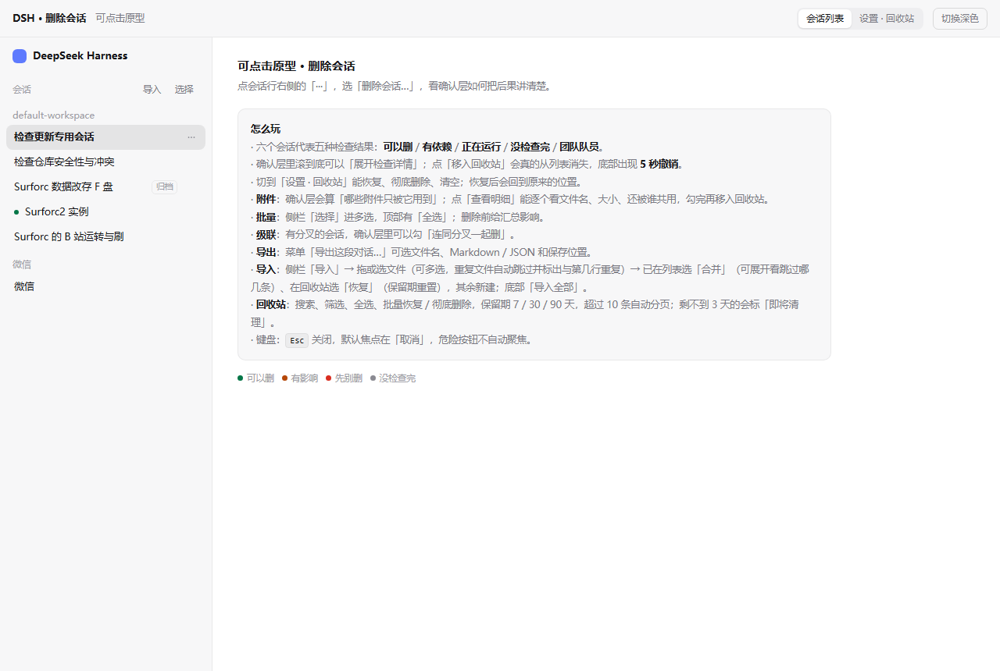
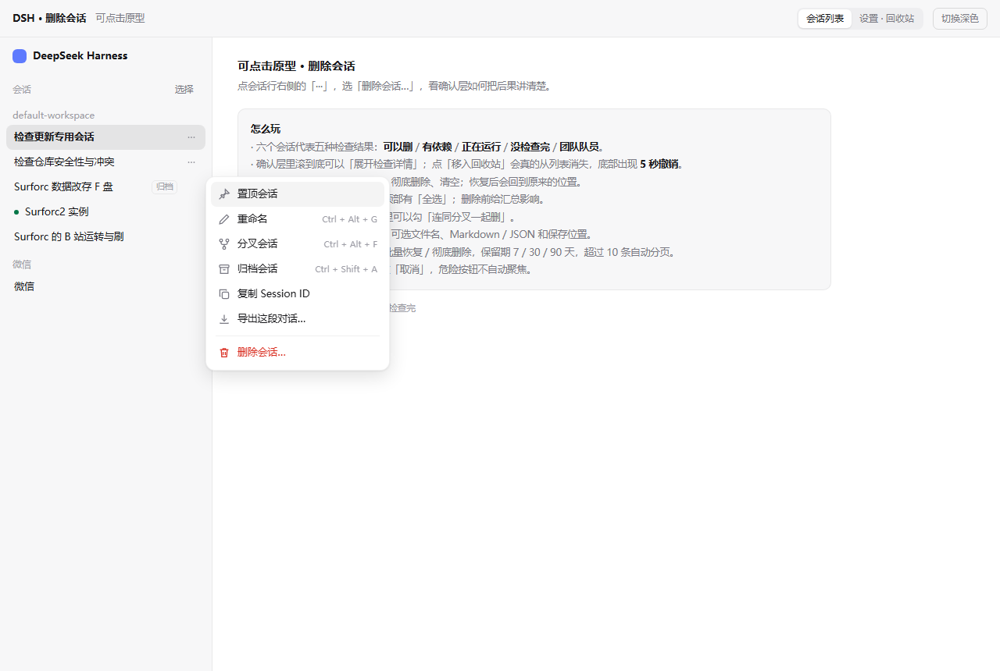
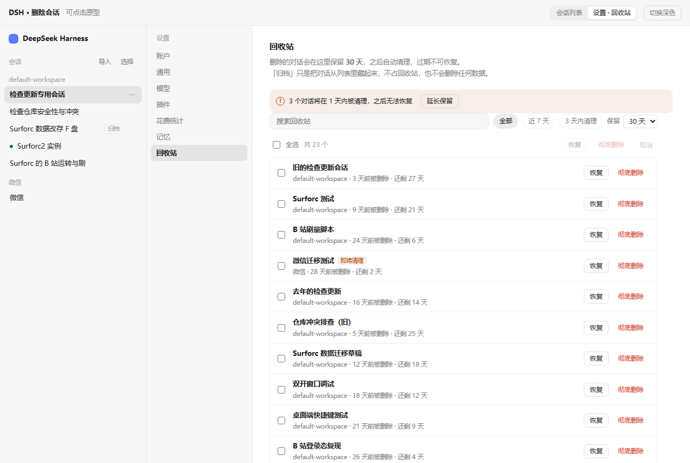
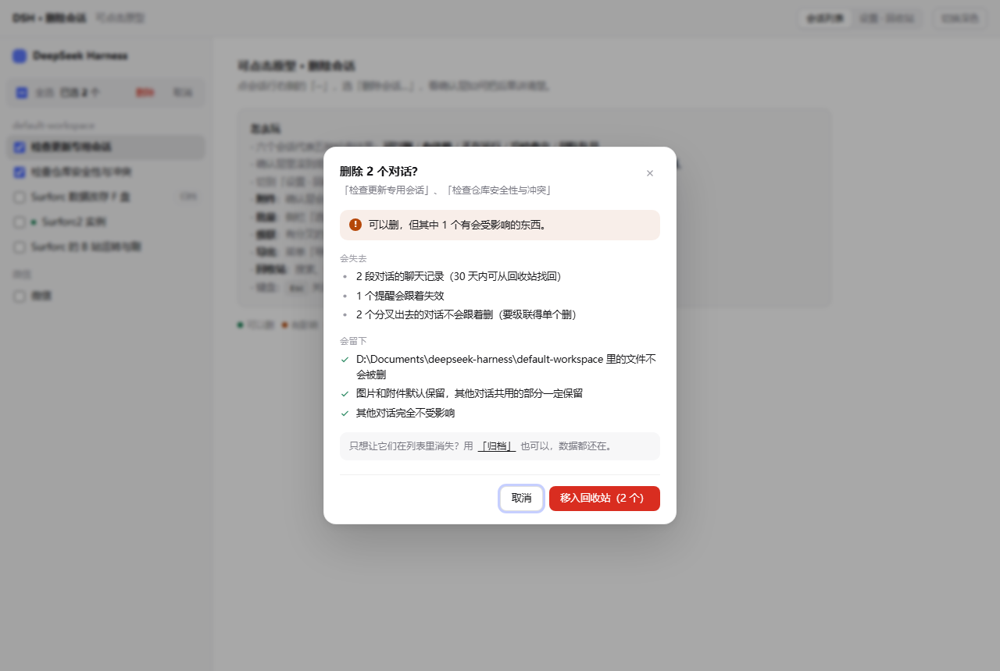
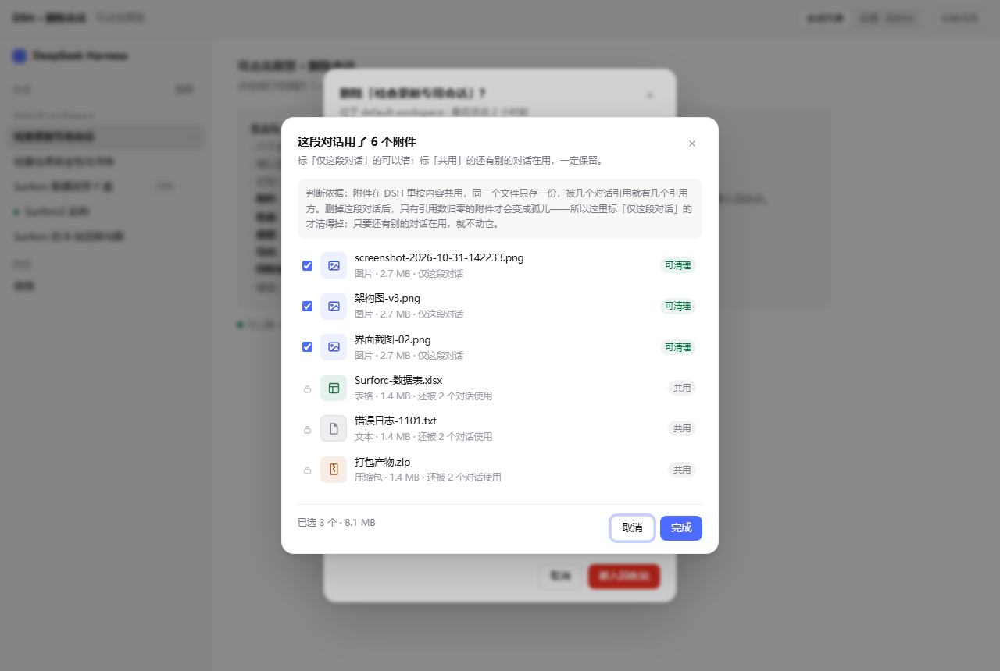
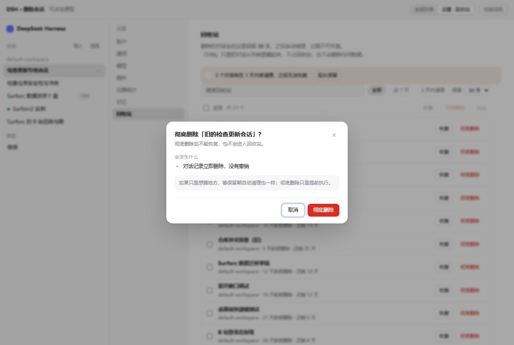

# dsh-session-trash

> DSH 会话回收站 —— 让「删除会话」变成可撤销的操作。

**License** MIT · **Node** ≥ 20 · **依赖** 零第三方依赖 · **网络** 纯本地，无出站连接

[DSH (DeepSeek Harness)](https://github.com/deepseek-ai) 默认删除会话是直接从工作区列表里摘掉，误删之后只能去磁盘上翻目录。这个插件把删除改成两步：**先移进回收站，保留期内随时可以恢复，到期自动清理**。

> **非官方插件**：本项目由社区开发者维护，不是 DeepSeek 官方项目，与 DeepSeek 官方无隶属关系。完整免责条款见 [DISCLAIMER.md](DISCLAIMER.md)。

## 它解决什么问题

DSH 里「会话」不是一个数据库行，而是磁盘上的一个目录：

```
~/.dsh/sessions/<工作区目录名>/<sessionId>/session.v4.jsonl.zstd
```

哪个会话属于哪个工作区，记在 `~/.dsh/storages/workspace.json` 的名单里。原生删除只做「从名单里摘掉 + 删目录」，没有回收站，也没有撤销。

这带来三个实际问题：

1. **手滑即永久丢失** —— 删除没有二次确认和留档，误删就只能靠时间机器 / 文件恢复工具；
2. **不知道删掉了什么** —— 删除前看不到会话多大、有没有附件、是不是正在运行；
3. **删完侧栏还挂着** —— 内存里的工作区快照没刷新，界面上还看得到，点进去报错。

这个插件针对性地做了三件事：**回收站（可恢复）、删除前分析（知道在删什么）、留档（留一手证据）**，另外补了孤儿目录清理、退出自检、崩溃自愈这些运维向能力。

## 截图

| 删除入口 | 删除前分析 |
|---|---|
|  |  |
| **回收站** | **批量操作** |
|  |  |
| **附件明细** | **彻底删除** |
|  |  |

## 功能

- **删除会话**：会话「⋯」菜单最下面多一项「删除会话」（红色，单独一排）。
- **删除前分析**：先告诉你这个会话在不在本地、目录多大、是否归档 / 置顶 / 还在运行，再让你确认。
- **移入回收站**：会话目录搬到 `~/.dsh/session-trash/payload/<trashId>/`，同时从 `workspace.json` 的三处名单里摘掉（改动前自动备份）。
- **回收站管理**：设置 → **回收站**，列出所有条目，可以恢复（回原位、恢复归档/置顶状态）、彻底删除、批量操作。
- **保留期**：默认 30 天，可配置 5–1440 天；到点自动清理，每次动作写 `journal.jsonl`。
- **文件留档**：删除前自动生成元数据快照（zstd 压缩 + sha256 校验），留档失败会中止删除。
- **退出自检 + 崩溃自愈**：页面退出时做一次只读体检；启动时把回收站索引与磁盘目录对齐。
- **孤儿会话目录清理**：找出磁盘上不属于任何工作区的会话目录，可以批量移进回收站。

## 安装

本插件通过 `package.json` 里的 `dsh` 字段和 `cordis.patch.yml` 声明，属于 DSH 的 Web 客户端插件。

1. 克隆或下载本仓库：

   ```bash
   git clone https://github.com/a307608689-afk/dsh-session-trash.git
   ```

2. 把插件目录放到 DSH 能加载的位置，或在 DSH 的插件管理界面里添加本地路径；
3. 完全退出并重新启动 DSH；
4. 打开 **设置 → 回收站**，能看到条目列表就说明加载成功。

具体加载方式随 DSH 版本可能不同，以你所用版本的插件文档为准。

**环境要求**：Node.js ≥ 20、DSH Web 端。

## 使用

### 删除一个会话

1. 在侧栏找到会话，点它右侧的「⋯」菜单；
2. 选最下面的 **删除会话**；
3. 看完分析信息，点确认 —— 会话进入回收站。

### 恢复或彻底删除

**设置 → 回收站**：

- 「恢复」：把会话目录搬回原位，归档 / 置顶状态一并恢复；
- 「彻底删除」：不可撤销，删除前会先做一次留档；
- 支持勾选多条批量操作。

### 保留期

默认 30 天。到期后自动清理（插件每分钟检查一次，默认每 30 分钟执行一轮）。

```bash
# 改成 90 天（接口方式）
curl -X POST http://127.0.0.1:<端口>/dsh-session-trash/config \
  -H 'content-type: application/json' \
  -d '{"retentionDays":90}'
```

`autoPurgeMinutes` 可设 5–1440，`0` 表示关闭自动清理。

## 实现方式

> 细节见 [docs/ARCHITECTURE.md](docs/ARCHITECTURE.md)。

插件分两半：

| 部分 | 文件 | 做什么 |
|---|---|---|
| 宿主半端 | `index.js` | 路由、存储、删除 / 恢复 / 留档 / 清理逻辑 |
| 浏览器半端 | `client.js` | 会话菜单、删除确认框、设置页「回收站」 |
| 共享工具 | `lib/path-safety.mjs`、`lib/tree.mjs` | 路径边界、目录统计（纯函数，可单测） |

关键设计：

- **删除 = 搬目录 + 摘名单**：不碰 `session.v4.jsonl.zstd` 内容，原始文件永远能拿回来；
- **唯一写入口**：所有对 `workspace.json` 的写入都走 `writeWorkspaceDoc()` —— 字段校验 → 版本戳复核 → 原子写 → 回读校验，任一步不通过就抛错，**一个字节都不写**；
- **并发不静默降级**：进程内串行 + 跨进程锁目录，拿不到锁明确返回 `TRASH_BUSY`，不假装成功；
- **留档带校验**：zstd + sha256，还原前先验哈希，包内路径逐条过越界检查。

## 数据与隐私

**这是一个纯本地插件，不会向任何外部服务器发送数据。**

| 数据 | 位置 | 说明 |
|---|---|---|
| 回收站索引 | `~/.dsh/session-trash/index.json` | 条目元数据 |
| 审计日志 | `~/.dsh/session-trash/journal.jsonl` | delete / restore / purge / auto-purge / boot，超过 2 MB 自动轮转，保留 5 份 |
| 被移除的会话 | `~/.dsh/session-trash/payload/<trashId>/` | 原样搬走的会话目录 |
| 备份 | `~/.dsh/session-trash/backups/` | 每次改 `workspace.json` 之前的备份 |
| 留档 | `~/.dsh/session-trash/archive/` | zstd + sha256 的元数据快照，默认配额 2 GB |
| 退出自检结果 | `~/.dsh/session-trash/last-exit.json` | 上一次退出的体检状态 |

会被改写的宿主文件只有 `~/.dsh/storages/workspace.json`，而且所有写入都走唯一入口 `writeWorkspaceDoc()`：结构校验 → 备份 → 原子写 → 回读比对，任一步不通过就回滚。

**诊断包**（设置 → 回收站 → 安全 → 导出诊断包）**不含对话正文**，只有健康状态、条目摘要、留档摘要和最近 200 条 journal，可以直接发给帮忙排查的人。

## 安全性

| 检查项 | 结论 |
|---|---|
| 外部网络请求 | **无**。前端只请求同源 `/dsh-session-trash/*`，服务端无任何出站连接 |
| 第三方依赖 | **无**。`package.json` 没有 `dependencies` / `devDependencies`，只用 Node 内置模块 |
| 动态代码执行 | **无** `eval` / `new Function` / 由用户输入驱动的动态 `import` |
| 路径穿越 | `pathInside()` + `safeJoinInside()` 双重校验，拒绝绝对路径、盘符、`..` 逃逸 |
| 输入校验 | 所有 POST body 逐字段判类型；保留期只接受 7/30/90，自动清理间隔限 5–1440 |
| 权限 | 只读写 `DSH_HOME` 下的目录，不需要管理员 / root |
| 敏感信息 | 仓库内无 token、密码、私钥、邮箱、手机号；本机路径已全部替换为环境变量或相对路径 |
| 数据外发 | 无。诊断包在本地生成，是否发出去由你自己决定 |

自测命令（想自己验一遍的话）：

```bash
# 语法检查
node --check index.js && node --check client.js && node --check selftest.mjs

# 单测：路径越界、盘符、..、目录统计与复制比对
npm test
```

## HTTP 接口

插件在 DSH 同源下注册了这些接口：

| 方法 | 路径 | 说明 |
|---|---|---|
| GET  | `/dsh-session-trash/health` | 自检：home、保留期、条目数 |
| GET  | `/dsh-session-trash/list`   | 回收站列表（顺带执行到期清理） |
| POST | `/dsh-session-trash/analyze`| `{sessionId}` → 删除前分析 |
| POST | `/dsh-session-trash/delete` | `{sessionId, title}` → 移入回收站 |
| POST | `/dsh-session-trash/restore`| `{trashId}` → 恢复原位 |
| POST | `/dsh-session-trash/purge`  | `{trashId}` → 彻底删除 |
| GET  | `/dsh-session-trash/orphan-dirs` | 孤儿会话目录列表 |
| POST | `/dsh-session-trash/orphan-dirs` | `{sids:[...]}` → 移入回收站 |
| GET  | `/dsh-session-trash/archive` | 留档列表 |
| POST | `/dsh-session-trash/archive/restore` | `{archiveId}` → 还原删除前快照 |
| POST | `/dsh-session-trash/archive/purge` | `{archiveIds:[...]}` → 清理留档 |
| GET  | `/dsh-session-trash/export/stream` | 流式导出会话 |
| GET  | `/dsh-session-trash/diagnostics` | 诊断包（不含对话正文） |
| GET  | `/dsh-session-trash/config` | 读取配置 |
| POST | `/dsh-session-trash/config` | 修改保留期 / 自动清理间隔 |

## 已知边界

- **删除后侧栏不会立刻消失**：DSH 的工作区快照在内存里，界面会提示「刷新列表」，后续版本会改走工作区服务的事件通知；
- 附件默认只统计不物理删除；「只解绑不删除」与彻底删除时释放空间仍在开发中；
- 分叉 / 子会话、定时提醒、目标（goal）依赖暂不进入删除前分析；
- 恢复只按 `workspace.json` 原位插回，跨工作区移动的场景未处理；
- 孤儿附件（对象目录里已无会话引用）的统计与清理未做；
- 团队会话禁止级联删除的前端提示未做。

## 故障排查

### 重启后工作区 / 会话全空，新对话报 `workspaceController is unavailable`

**症状**：DSH 重启后侧栏一个工作区都没有；点「新对话」弹出

```
workspace create failed: gateway/service-unavailable: typert gateway: workspace/create: active Service "workspaceController" is unavailable
```

**原因**：`<DSH_HOME>/storages/workspace.json` 里 `tables.workspaces[*]` 的时间字段（`updatedAt` / `createdAt` / `lastUsedAt`）被写成了**数字**。宿主的 workspace 存储按 ISO 字符串校验，整份文件反序列化失败，workspace 服务起不来。

**会话文件没有丢** —— `~/.dsh/sessions/` 下的目录都还在，只是服务没起来。

**排查**（只读，不改文件）：

```bash
node dsh-session-trash/tools/fix-workspace-timestamps.mjs
```

输出里若有 `FIX ... updatedAt: 1793… -> "2026-…Z"` 就说明命中了。

**修复**：

1. 完全退出 DSH（关窗口不够，要退出进程）；
2. `node dsh-session-trash/tools/fix-workspace-timestamps.mjs --write`（会先备份成 `workspace.json.bak-<时间>`）；
3. 重新启动 DSH。

**不要做的事**：出现这个症状时不要点「重新选择文件夹」重建工作区 —— 那会把 `workspace.json` 写成全新的空结构，覆盖掉原来的 `sessionIds` 名单（数据还在，但列表要手工重建）。

从 0.1.1 起，本插件侧已加了三道闸来防止复发：唯一写入口 `writeWorkspaceDoc()`、写前版本复核、进程内串行互斥；读取时发现历史数字时间戳会自动转 ISO 并记录。

### 端口不是 6133 / 45155

自测与集成测试里的端口是示例值，用环境变量覆盖：

```bash
TRASH_BASE=http://127.0.0.1:<你的端口>/dsh-session-trash node selftest.mjs
```

## 卸载 / 回滚

**先回滚，再卸载**（反过来会让回收站里的会话一直留在 `session-trash/`，界面上看不到）：

1. 跑一遍 dry-run，看看会搬回哪些：

   ```bash
   node tools/rollback-trash.mjs
   ```

2. 确认后真正执行（会先备份 `workspace.json`）：

   ```bash
   node tools/rollback-trash.mjs --write
   ```

3. 在 DSH 设置里关掉 / 移除插件，然后完全退出并重启 DSH；
4. 确认列表里的对话都回来了，再决定要不要删 `~/.dsh/session-trash/`（里面还有 `backups/` 和 `archive/` 留档，想留证据就先别删）。

脚本不会删除 `index.json`，也不会动留档包；它只做「把 payload 搬回原位 + 把 sid 写回工作区名单」。

## 开发与测试

```bash
# 纯函数单测（路径越界、盘符、..、目录统计与复制后比对，共 15 项）
npm test

# 自测：在真实会话根目录下造假会话，全程只走插件自己的 HTTP 接口
node selftest.mjs

# 集成测试：跑在真实 DSH 实例上的假数据，结束时清理干净
node test/integration.mjs
```

自测与集成测试都不接触真实对话内容，跑完会自己清理。

## 更新日志

见 [docs/CHANGELOG.md](docs/CHANGELOG.md)。

## 免责声明

本插件会**真实移动和删除**你磁盘上的会话目录，并改写 `~/.dsh/storages/workspace.json`。**彻底删除不可撤销**。请在使用前自行备份，或先在测试环境验证。

本软件按「现状」提供，不附带任何担保；作者不对数据丢失、工作区损坏、业务中断等后果承担责任。完整条款见 **[DISCLAIMER.md](DISCLAIMER.md)**。

## 许可证

[MIT](LICENSE) © 2026 a307608689-afk
